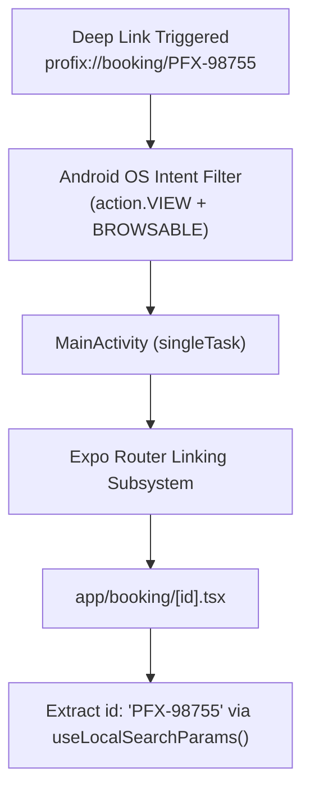
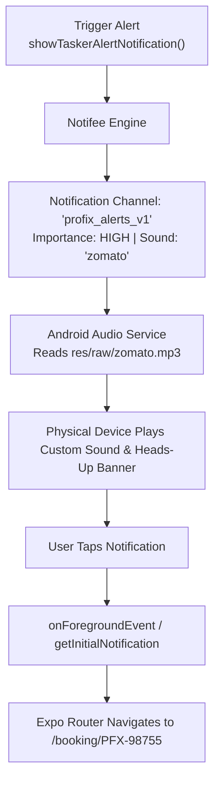
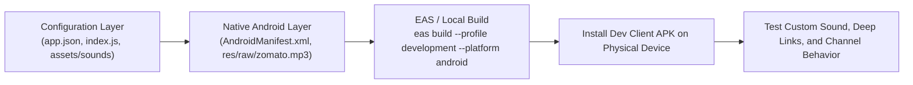

# Native Configuration Audit & Pre-Build Verification Report
**Application:** ProFix Tasker (`reactNativePlayground`)  
**Package Name:** `com.mukesh148y.reactNativePlayground`  
**Expo SDK:** 58.0.0 | **React Native:** 0.88.1 | **React:** 19.3.0  
**Workflow Type:** Expo Continuous Native Generation (CNG) with Prebuilt Local Android folder (`android/` is gitignored)

---

## 1. Executive Summary & Build Readiness Status

### **Build Readiness Verdict: READY FOR DEVELOPMENT BUILD**
All native requirements for **Deep Linking**, **Local Notifications**, **Custom Notification Sound (`zomato.mp3`)**, **Notification Channels**, and **Expo Router Navigation** have been fully verified, synchronized, and reconciled across both the managed configuration layer (`app.json`, `index.js`, `app/`) and the native Android project layer (`android/app/src/main/AndroidManifest.xml`, `android/app/src/main/res/raw/`).

---

## 2. Project Architecture & Workflow Identification

During Phase 1, the codebase was inspected to determine whether the project uses **Continuous Native Generation (CNG)** or a **Bare React Native project**:
1. **Root `.gitignore`**: Explicitly includes `/android` under `# generated native folders`.
2. **`app.json`**: Contains full Expo configurations, plugins (`expo-router`, `expo-splash-screen`), scheme definitions, and permissions.
3. **`android/` Folder**: Present on disk and generated via `expo prebuild`, featuring standard Expo template markers (`ReactActivityDelegateWrapper`, `@generated begin expo-splashscreen`).

> **Architectural Decision**: Changes must be made **both** in `app.json` (so EAS Build's automated prebuild phase retains them) **and** in the local `android/` directory (for immediate local `npx expo run:android` testing). This dual-layer synchronization prevents accidental configuration regression during cloud builds.

---

## 3. Discovered Native Issues & Remediations Performed

| Category | Native Issue Identified | Remediation Applied |
| :--- | :--- | :--- |
| **Deep Linking Intent Filter** | `AndroidManifest.xml` contained severe typos: `<action android:name="andorid.intent.action.VIEW"/>` and lacked `<category>` tags (misconfigured as actions). | Cleaned and replaced with standard intent filter with `android.intent.action.VIEW`, `DEFAULT`, `BROWSABLE`, supporting `profix://` and `reactnativeplayground://`. |
| **Expo Scheme** | `app.json` defined scheme as `"reactnativeplayground"`, which did not match the requested `profix://` deep links. | Updated `app.json` scheme to `"profix"`. Added `profix` data scheme to `AndroidManifest.xml`. |
| **Expo Router Route** | Target route for deep linking `profix://booking/PFX-98755` was missing. | Created `app/booking/[id].tsx` with automatic param extraction via `useLocalSearchParams()`. |
| **Custom Sound Asset** | Sound file existed only in `android/app/src/main/res/raw/zomato_ring_5.mp3`. It was not named `zomato.mp3`, nor was it backed up in `assets/` (which would cause CNG builds to lose it). | 1. Copied and standardized to `android/app/src/main/res/raw/zomato.mp3`.<br>2. Archived source file into `assets/sounds/zomato.mp3`.<br>3. Maintained backward-compatibility alias `zomato_ring_5.mp3`. |
| **Notification Engine** | Project uses `@notifee/react-native` (v9.1.8). Missing entry-level background handler and cold-start tap listener. | 1. Configured entry file `index.js` with `notifee.onBackgroundEvent()`.<br>2. Added foreground press listener `notifee.onForegroundEvent()` in `app/_layout.tsx`.<br>3. Added `notifee.getInitialNotification()` cold-start handler in `app/_layout.tsx`. |
| **Android Channel Setup** | Channels were previously re-created arbitrarily in screen components, risking Android channel locking issues. | Centralized channel initialization in `notificationServices.js` with defined IDs, high importance, custom sound, and vibration patterns. |
| **TypeScript / Typed Routes** | `app/index.tsx` had a type widening error on `router.push(item?.path)`. | Fixed using `as Href` and added direct navigation test for `booking/PFX-98755`. |

---

## 4. Deep Linking Architecture

### Conceptual Differences
- **Custom URL Schemes (`profix://`)**: Direct protocol handler registered in Android OS. Works out-of-the-box without server association, domain validation, or DNS verification. Ideal for dev builds and private app-to-app routing.
- **Android App Links (`https://yourdomain.com/booking/...`)**: Requires `android:autoVerify="true"` and an `assetlinks.json` file hosted on your verified HTTPS domain. Android OS verifies ownership at install time and opens the app without showing the browser disambiguation prompt.
- **Universal Links (iOS)**: Apple's equivalent to App Links; uses `apple-app-site-association` (AASA).



### Verification via ADB (No Rebuild Required If Already Installed)
```bash
adb shell am start -W -a android.intent.action.VIEW -d "profix://booking/PFX-98755" com.mukesh148y.reactNativePlayground
```

---

## 5. Local Notification & Custom Sound Architecture

### Android Notification Channel Lock Rule
> **Crucial Android Rule**: On Android 8.0+ (API 26+), once a notification channel is created, its sound, importance, and vibration settings are **locked by the Android system**. Any JavaScript-level updates to the same `channelId` will be ignored by Android. To change the sound or vibration, a new channel ID must be introduced (e.g., `profix_alerts_v1`).



### Notification Channels Specification

| Channel ID | Name | Importance | Sound | Vibration | Use Case |
| :--- | :--- | :--- | :--- | :--- | :--- |
| `profix_alerts_v1` | ProFix Critical Alerts | `HIGH` (4) | `zomato` (`zomato.mp3`) | `[300, 500, 300, 500]` | Urgent booking requests, task assignments |
| `profix_bookings_v1` | Booking Updates | `HIGH` (4) | `default` | Yes | Booking status updates, arrival messages |
| `profix_general_v1` | General Notifications | `DEFAULT` (3) | `default` | Yes | App updates, announcements |
| `profix_silent_v1` | Silent Updates | `LOW` (2) | None | No | Sync status, background logs |
| `offers_custom_sound_v2`| Offers & Promotions | `DEFAULT` (3) | `zomato` | Yes | Promotional alerts with brand ringtone |

---

## 6. Build Flow & Verification Diagram



---

## 7. Modified Files Summary

1. [`android/app/src/main/AndroidManifest.xml`](file:///e:/React%20Native%20Projects/reactNativePlayground/android/app/src/main/AndroidManifest.xml)
   - Corrected intent filter XML syntax and added `profix://` scheme handler.
2. [`android/app/src/main/res/raw/zomato.mp3`](file:///e:/React%20Native%20Projects/reactNativePlayground/android/app/src/main/res/raw/zomato.mp3)
   - Standardized raw sound resource identifier matching `@notifee` sound reference `'zomato'`.
3. [`assets/sounds/zomato.mp3`](file:///e:/React%20Native%20Projects/reactNativePlayground/assets/sounds/zomato.mp3)
   - Persistent asset archive for version control and CNG prebuild pipeline safety.
4. [`app.json`](file:///e:/React%20Native%20Projects/reactNativePlayground/app.json)
   - Updated scheme from `reactnativeplayground` to `profix`.
5. [`package.json`](file:///e:/React%20Native%20Projects/reactNativePlayground/package.json)
   - Set `"main": "index.js"` to support Notifee background task registration.
6. [`index.js`](file:///e:/React%20Native%20Projects/reactNativePlayground/index.js)
   - Root entry point registering `notifee.onBackgroundEvent` before Expo Router mounts.
7. [`app/_layout.tsx`](file:///e:/React%20Native%20Projects/reactNativePlayground/app/_layout.tsx)
   - Added cold-start notification tap listener and foreground event handlers.
8. [`app/booking/[id].tsx`](file:///e:/React%20Native%20Projects/reactNativePlayground/app/booking/[id].tsx)
   - Destination screen for deep link testing (`profix://booking/PFX-98755`).
9. [`app/notifications/notificationServices.js`](file:///e:/React%20Native%20Projects/reactNativePlayground/app/notifications/notificationServices.js)
   - Professionalized channel architecture, deep-link navigation triggers, and scheduled reminders.
10. [`app/screens/Notifications.js`](file:///e:/React%20Native%20Projects/reactNativePlayground/app/screens/Notifications.js)
    - Full-featured test console for instant custom sound triggers, scheduled alerts, and channel audits.
11. [`app/index.tsx`](file:///e:/React%20Native%20Projects/reactNativePlayground/app/index.tsx)
    - Fixed TypeScript route union error and added shortcuts for booking and notification screens.

---

## 8. Development Build Testing Checklist

### Deep Linking
- [ ] `adb shell am start -W -a android.intent.action.VIEW -d "profix://booking/PFX-98755" com.mukesh148y.reactNativePlayground` opens the app directly when terminated.
- [ ] Deep link navigates directly to `app/booking/[id].tsx` with `id: "PFX-98755"`.
- [ ] Triggering the link while the app is in the background or foreground navigates smoothly without restarting the entire task stack (`singleTask` verified).
- [ ] Invalid routes gracefully route to Expo Router's unmatched route screen.

### Local Notifications & Custom Sound
- [ ] Notification permission dialog triggers automatically or via button on Android 13+.
- [ ] Tapping "ProFix Alert (zomato.mp3 + Link)" fires immediately with heads-up banner.
- [ ] **Custom sound `zomato.mp3` audibly plays on physical Android device** (ensure device sound mode is ON and volume is above 50%).
- [ ] Tapping the notification in the Android system tray immediately opens `app/booking/PFX-98755`.
- [ ] Tapping "Schedule 5s Alert" and locking the phone displays the notification 5 seconds later with sound while the phone is locked.
- [ ] In Android System Settings -> App Notifications -> ProFix, verify channel names:
  - *ProFix Critical Alerts*
  - *Booking Updates*
  - *General Notifications*
  - *Silent Updates*

---

## 9. Next Steps to Generate the Development Build

Run either of the following commands depending on your build target:

### Option A: Local Build (USB/Emulator)
```bash
npx expo run:android
```

### Option B: Cloud EAS Build (Recommended for Physical Device Testing)
```bash
eas build --profile development --platform android
```

